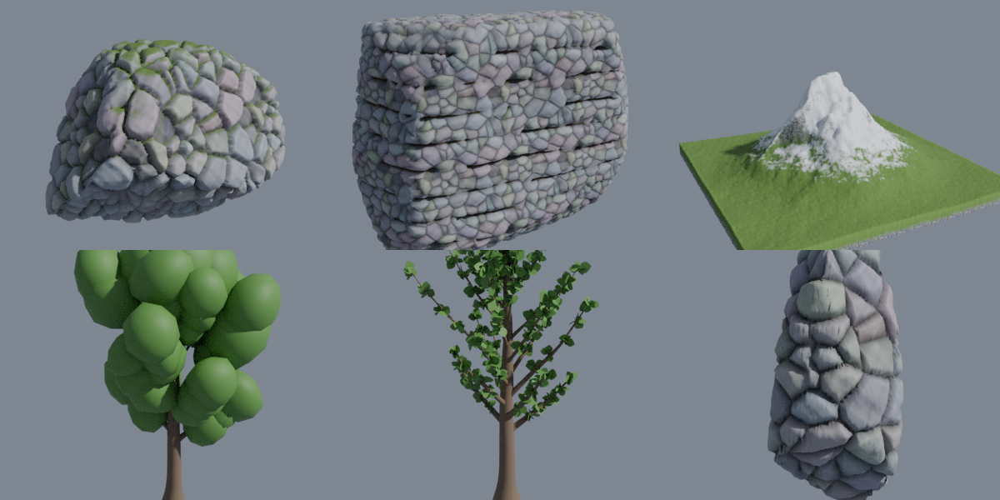
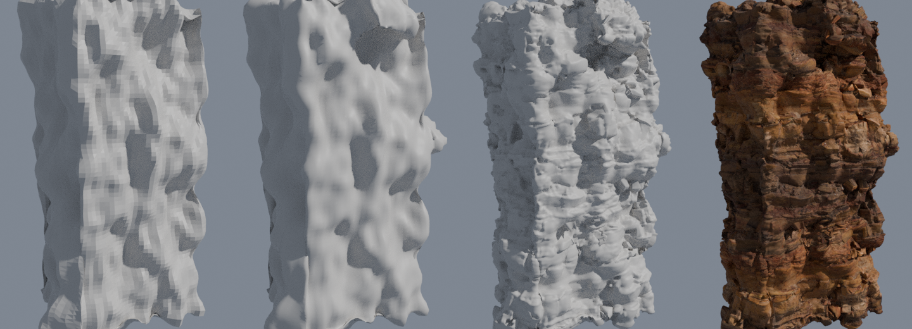

# Nature Forge

Geometry Nodes generators for game environments: **rocks, cliffs, mountains and trees**, plus **Rockify** for
your own meshes. Every shape stays live, so you can keep moving the sliders. Your texture sets are hooked up
automatically: you never connect maps by hand. The height map of a texture set becomes real 3D detail, and the
color / normal / roughness maps line up exactly on those bumps.

*(Preview rendered with a test stone texture. With your Paid Mats the detail comes from your own height maps.)*

Blender 4.2 or newer. Tested on 4.2 and 5.1. Sidebar: **3D View > N > Forge**.

---

## Install

1. Zip the `nature_forge` folder (the zip must contain the folder itself, not just its files).
2. Blender: **Edit > Preferences > Add-ons > Install from Disk...** and pick the zip. It works as an extension
   (4.2+) and as a classic add-on.
3. Enable **Nature Forge**. You also get *Shift+A > Mesh > Nature Forge ...* entries.

## 1. Set up your texture library (one time)

**Forge > Texture Library > folder icon > Add Library Folder.** Pick the top folder. All subfolders are scanned,
for example:

| Your folder | What it finds |
|---|---|
| `S Assets/PRB/Paid Mats 3D/tex` | every `V7_Wood_Base_02/` style folder: `color.jpg`, `normal.jpg`, `rough.jpg`, `ao.jpg`, `height.png`. The folder name is the set name, and `info.json` is read (see below) |
| `S Assets/PRB/Paid Mats/99 Pack Vol (1)` | every `Textures/Food_Cheese_basecolor.png`, `..._normal.png`, ... set. Stray pictures like `Material Index.jpg` are ignored |

Recognised maps (any common naming: `_basecolor`, `_albedo`, `_Color`, `_nrm`, `_NormalGL`/`_NormalDX`,
`_roughness`/`_gloss`, `_metallic`, `_ao`, `_height`/`_displacement`/`_bump`, `_opacity`, packed `_ORM`/`_ARM`,
`_emission`, `2k`/`4k` suffixes...):

* **Normal maps**: OpenGL is the default. A file named DX/DirectX, or an `info.json` that says so, flips the green
  channel automatically. You can also toggle it per layer.
* **Gloss** maps are inverted to roughness automatically.
* **info.json**: a `files` list (`{"color": "color.jpg", "height": "height.png", ...}`) decides which file is which
  map. `normal_src` (`gl` / `dx`) sets the normal convention, and `h_mean` becomes the displacement mid level. Clear
  keys like `displacement` / `depth`, `size` / `real_size`, `category` or `name` are used the first time you apply
  that set. What was found is shown under the preview.

The scan is cached, so Blender starts instantly. Press the refresh button after you add new materials, or enable
*Scan on Startup* in the add-on preferences.

`.sbs` / `.sbsar` files are Substance source files that Blender can't read. Use the exported `Textures` folder of the
pack instead. To use `99_Procedural_materials.blend`, open it, mark its materials as assets and use them with the
Material Layer Mixer.

## 2. Create

**Forge > Nature Forge**: click **Rock**, **Cliff**, **Mountain** or **Tree**. The preset button next to each one
offers starting points:

* **Rock**: Boulder, Pebble, Slab, Shard, Chiselled Block, Weathered Boulder
* **Cliff**: Rock Wall, Layered Cliff, Basalt Columns, Overhang, Curved Bay
* **Mountain**: Alpine Peak, Range, Rolling Hills, Mesa, Volcanic Cone, Terrain Tile
* **Tree**: Oak (leaf cards), Stylized Blob Tree (low-poly clumps), Pine, Birch, Umbrella, Dead Tree
* **Rockify Selected**: your own model gets subdivided and displaced by the texture's height map (the "make it
  rocky with the displacement texture" trick). The subdivision level is chosen so the result stays under about
  400k faces.

**Shape panel**: a Seed (arrows = next / previous, refresh = random) and every control, in folding sections:

| Generator | Controls |
|---|---|
| Rock | size, resolution, lumps, taper, flat bottom, **facets** (flat broken faces), **chips** (flakes), smooth edges, **cracks**, **strata** layers, surface noise, detail level |
| Cliff | width / thickness / height, roundness, taper, **overhang**, **curve** (bay), flat back, rock masses, facets, **ledges** (count, sharpness, tilt, warp), cracks with **vertical stretch** (basalt joints), detail |
| Mountain | size, height, resolution, peak falloff (peak to open terrain), sharpness, **ridges**, feature size, warp, range stretch, **erosion**, valleys, floor, **plateau**, **terraces**, solid base skirt |
| Tree | trunk height / radius / taper / root flare / bend / lean, branch count / start / angle / length, **crown shape** (cone > round > umbrella), droop, upturn, wiggle, twigs, **leaf type** (cards or clumps), leaf size / count, clump size / lumps |

Values can also be edited (or keyframed) in the normal modifier panel. *Reset* in each section restores its
defaults.

## 2b. Step by Step (the hand-made / tutorial workflow)

*(Blockout, converted with chunks, rock detail from the displacement map, final material. Made with the
`cliff_side` texture set.)*

When you'd rather build it by hand, **Forge > Step by Step** walks you through the classic workflow from the
tutorials. Each step is one button, everything stays a normal Blender modifier, and you can go **Back / Next** at
any time:

| Step | Button | What happens | What you can tweak |
|---|---|---|---|
| Start | **Rock / Cliff / Slab / Pillar** or **Use 'your mesh'** | a block at the 3D cursor (or your own model) | — |
| 1 Blockout | **Add Remesh + Clouds** | voxel Remesh + Displace with a Clouds texture: one lumpy, solid rock mass | voxel size, strength, midlevel, seed, cloud size, vertical stretch, detail, contrast, pattern (soft lumps, cells, cracked plates, crackle, blocks) |
| 2 Shape | **Edit Mode**, **Add Chunk**, **Convert to Mesh** | duplicate / move parts yourself (Shift+D, G, S, R) or add random chunks. The remesh welds them, then convert applies it. A hidden live copy is kept, and **Back to Blockout** brings it back with the same seed and sliders | chunk size, box or round |
| 3 Sculpt | **Start Sculpting**, brush buttons, **Apply Sculpt** | Multires + rock brushes (Clay Strips, Scrape, Flatten, Cracks, Crease, Pinch, Grab, Smooth) | sculpt resolution, keep level. *Skip* if you don't want to sculpt |
| 4 Unwrap | **Unwrap (Cube Projection)** | cube projected UVs at real-world size | **Texture Size** (stays live afterwards) |
| 5 Rock Detail | **Add Rock Detail** | Subdivision + Displace with the texture set's displacement map (UV): the rocky detail becomes real geometry | viewport / render subdivisions, strength, midlevel (taken from `info.json` `h_mean` when present), texture size |
| 6 Material | **Add All Textures** | color x AO, roughness, metal (or packed ARM / ORM), normal map, bump. All on the same UVs | everything in the Shader Editor. *Paint More Layers* hands it to the Material Layer Mixer |
| 7 Finish | **Bake Game LODs**, **Apply Everything**, **Make another one** | game-ready LODs, a real high-poly mesh, or the next rock | — |

Pick the texture set at the top of the panel, either from the **Texture Library** or **From Disk**: choose any one
map, e.g. `cliff_side_disp_4k.png`, and the diffuse, normal, roughness, AO and ARM files next to it are found
automatically.

Good to know:
* **Next** always works. If a step needs an earlier one finished (Unwrap needs the blockout converted and the
  sculpt applied), it does that for you and tells you.
* **Shift+D** a rock at any step to make a variation. The copy gets its own clouds, textures and material, so
  changing one never changes the other. A material you link to several rocks yourself (Ctrl+L) stays shared
  until you pick a different set for one of them.
* Every rock has its own material (`<rock>_<set>`). Your node edits are kept until you press **Rebuild Material**
  or pick a different set. Other materials you add (moss on some faces...) keep their slots. With **Paint More
  Layers** (Material Layer Mixer), picking a set swaps only the base layer; your Mixer layers stay. Opened
  without the Mixer add-on, a layered material is never replaced: enable the Mixer to change it.
* **Back to Blockout** only puts the mesh back. The object keeps its name, parent, children, animation, your own
  modifiers and its material.

## 3. Texture it (automatic)

Pick a set in **Texture Library** (search, category, big previews), then press **Apply to: Base**. Or use the
arrow button on a layer in **Material & Textures**. The folder button loads a set straight from disk: pick any one
map and the rest are found.

On the **Base** layer of a generator:

* **Texture Depth**: how far the height map pushes the surface out (real geometry).
* **Tile Size**: real-world size of one texture repeat. Color, normal and height always stay aligned.
* **Mid Level**, **Projection Blend** (triplanar: no UVs, no seams, no stretching on cliffs), **Invert Height**.
* **Mesh Detail**: more subdivisions for crisper displacement.
* Normal strength, DirectX flip, AO strength, and color adjust (hue, saturation, value, tint, roughness and
  metal offsets).

Sets without a height map displace with their color brightness.

## 4. Auto-paint layers (the "paint them" part)

**Add Paint Layer** stacks up to 3 layers over the base: Moss on Top, Snow, Dirt in Cracks, Worn Edges, Grass on
Flat Ground, Sand at the Bottom, Wet Streaks, or Paint Only. Each one starts with a flat fill color. Apply any
texture set to it (for example your moss or snow material).

*Where it appears* is fully adjustable:

* **Top** (+ up-facing / - steep), **Cavity**, **Edges**, **Height** (+ high / - low), mixed by **Combine**
  (OR to AND, e.g. snow only where it is high *and* flat).
* **Coverage**, **Sharpness**, **Noise** breakup and scale, **Crack Fill** (fills the low parts of the texture
  below first), **Detail**, **Opacity**.

Mountains start with Grass (low, flat) and Snow (high, flat) layers already set up.

**Cavity Darken / Edge Lighten** bake shape-based shading into the color, which helps in game engines without AO.

## 5. Paint by hand

**Paint, Finish & Bake > Paint: \<layer\>**. Painting needs a real mesh, so the generator is applied first. A hidden
editable copy is kept in *NF Editable Copies*, and **Back to Generator** brings it back. You land in Vertex Paint:
**Paint In** (white) adds the layer, **Paint Out** (black) removes it, on top of its automatic mask. Switch layers
with the buttons and finish with **Done Painting**.

## 6. Game export

* With the **Material Layer Mixer** enabled: **Bake Game LODs (Mixer)** bakes the object as it looks now (live
  generator or painted mesh) onto low-poly LODs. You get normal, color (with the auto-paint layers and AO), roughness
  and metal textures, plus Roblox splitting and GLB/FBX export. Levels and sizes are set in *Mixer tab > 3D Surface
  + LOD Bake*.
* **Make Real Mesh** gives you a plain high-poly mesh for sculpting or your own pipeline.
* **Make Asset Materials** (Texture Library) creates a regular UV material for every shown set, marked as an asset
  with `mlm_relief_depth`. Your whole library then shows up in the Asset Browser and in the Mixer's
  *Add as Mixer Layer*.

## Tips

* Face counts are shown under the Shape panel. Raise *Detail Level* only as far as the texture depth needs. For
  hero rocks 60k–250k faces is fine, since the LOD bake brings it down to your game budget.
* Placing rocks: their origin is at the bottom (*Sit on Ground*). Cliffs stand on z = 0 with the front facing -Y.
* Trees are made of a bark mesh plus leaves. Leaf cards use UVs, so leaf textures with opacity work as they are. Without
  one, a procedural leaf outline is used (*Leaf Shape*). Clumps are solid low-poly canopy blobs.
* Everything generated is plain Geometry Nodes / shader node groups (`NF Rock`, `NF Tex <set>` ...), so you can open
  and extend them.
